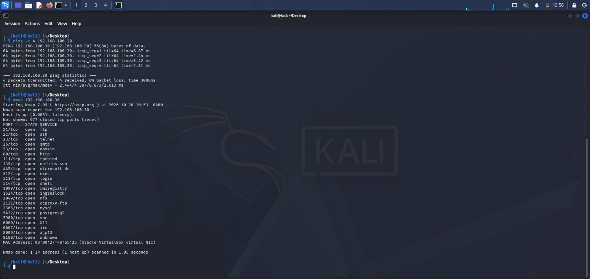
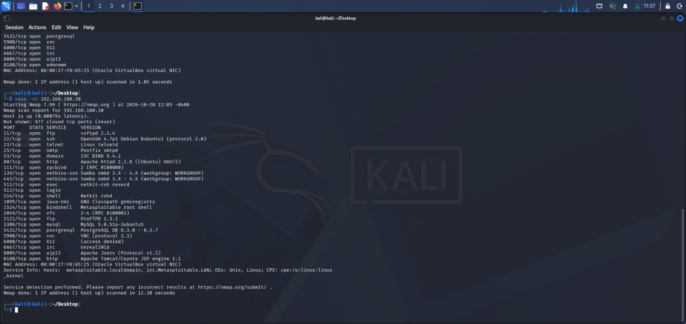
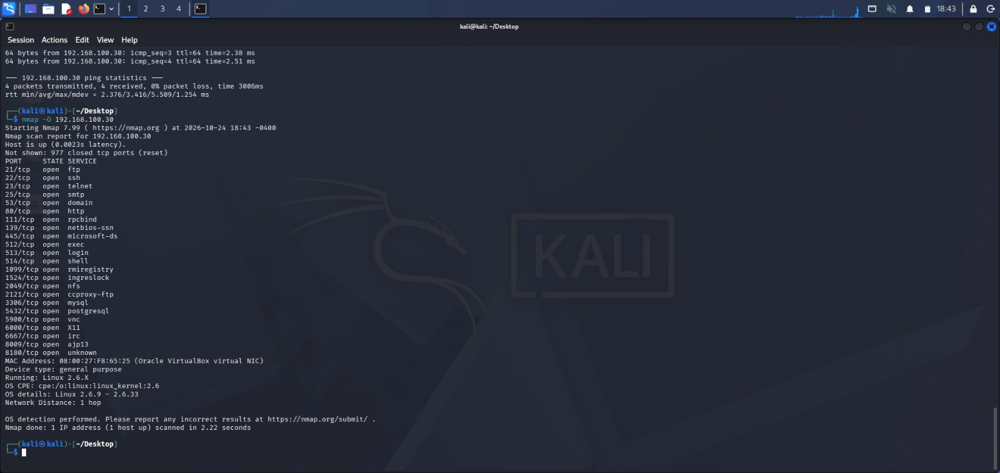
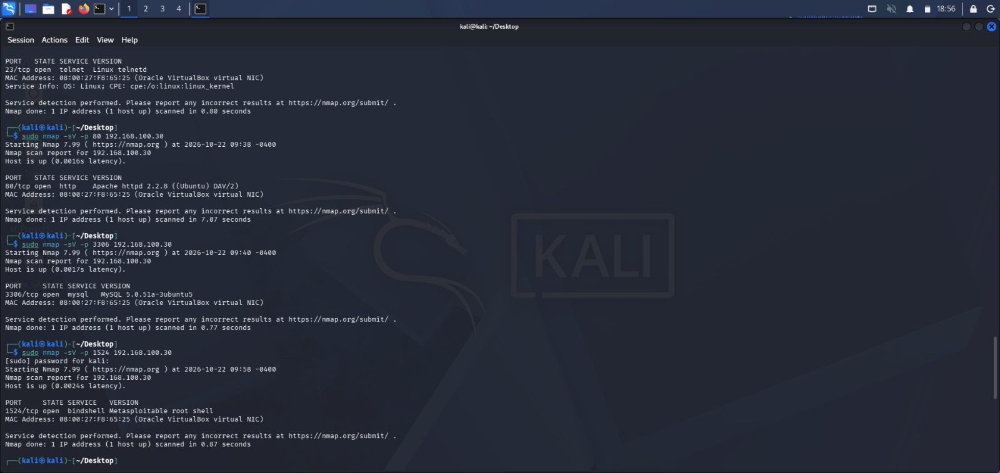

# Network Reconnaissance with Nmap

## Project Overview

This project focuses on network reconnaissance using Nmap to identify live hosts, discover open ports, detect running services, and estimate the target operating system.

The assessment was conducted in an authorized virtual lab using Kali Linux as the scanning machine and Metasploitable2 as the target machine.

The goal was to identify exposed services, assess potential security risks, and recommend appropriate remediation measures.


## Lab Environment

| Component | Details |
|---|---|
| Scanning Machine | Kali Linux |
| Scanning Machine IP | 192.168.100.20 |
| Target Machine | Metasploitable2 |
| Target Machine IP | 192.168.100.30 |
| Network Scanning Tool | Nmap 7.99 |
| Virtualization Platform | Oracle VirtualBox |
| Network Configuration | Internal Network (intnet) |

## Scope

The assessment was performed against the intentionally vulnerable Metasploitable2 virtual machine in an isolated lab environment.

All scanning activities were limited to the authorized target.


## Methodology

The assessment was completed in the following stages:

1. **Lab Setup:** Configured Kali Linux and Metasploitable2 in VirtualBox using an internal network.
2. **Connectivity Verification:** Used ping to confirm communication between the scanning machine and the target.
3. **Host and Port Discovery:** Used Nmap to confirm that the target was reachable and identify open TCP ports.
4. **Service and Version Detection:** Used Nmap service detection to identify running services and their reported versions.
5. **Operating System Detection:** Used Nmap OS detection to estimate the target operating system.
6. **Targeted Service Investigation:** Scanned selected ports to examine individual service and version results.
7. **Risk Assessment:** Reviewed the findings, identified potential security concerns, and developed remediation recommendations.


## Initial Port Scan

The initial Nmap scan confirmed that the Metasploitable2 target was reachable. It identified 23 open TCP ports and 977 closed TCP ports among the 1,000 default TCP ports scanned.




## Service and Version Detection

Nmap service and version detection was used to identify services running on the target and their reported versions. The results included FTP, SSH, Telnet, Apache HTTP Server, MySQL, and other services.




## Operating System Detection

Nmap OS detection estimated that the target was running a Linux 2.6.x kernel, with an estimated version range of Linux 2.6.9 to 2.6.33.

This result is an estimate based on network responses and should not be treated as definitive proof of the exact operating system version.




## Security Findings and Recommendations

### 1. Telnet — Port 23

**Evidence:** Nmap identified an open Telnet service on TCP port 23.

**Potential Risk:** Traditional Telnet does not encrypt session traffic, which could expose credentials and other information to someone monitoring the connection.

**Recommendation:** Disable Telnet if it is unnecessary. For remote administration, use SSH with secure configuration and restrict access to authorized systems.

### 2. Apache HTTP Server — Port 80

**Evidence:** Nmap identified Apache HTTP Server version 2.2.8.

**Potential Risk:** This is an obsolete software version that may lack important security updates.

**Recommendation:** Upgrade to a supported version, apply security updates, and test compatibility before deployment.

### 3. MySQL — Port 3306

**Evidence:** Nmap identified MySQL version 5.0.51a-3ubuntu5.

**Potential Risk:** The obsolete version warrants further security assessment. Database exposure and access controls should also be reviewed.

**Recommendation:** Restrict database access to authorized systems, review authentication and permissions, and plan an upgrade to a supported version.

### 4. Bindshell — Port 1524

**Evidence:** Nmap identified a service reported as a bindshell on TCP port 1524.

**Potential Risk:** A bindshell can provide a remote command interface and may represent a serious security concern.

**Recommendation:** Verify the service and its exposure in the authorized lab. Disable it if unnecessary and restrict access to any required services.

## Targeted Service Scan Results

Targeted Nmap scans were used to investigate selected services on the Metasploitable2 machine.

The results included:

- **Port 80 — HTTP:** Apache HTTP Server 2.2.8.
- **Port 3306 — MySQL:** MySQL 5.0.51a-3ubuntu5.
- **Port 1524 — Bindshell:** A service identified by Nmap as a bindshell.

These findings highlight services that warrant further security assessment and appropriate remediation.



## Commands Used

### 1. Connectivity Test

```bash
ping 192.168.100.30
```

Used to verify connectivity between Kali Linux and the target machine(metasploitable).

### 2. Initial Port Scan

```bash
nmap 192.168.100.30
```

Used to identify open TCP ports on the target.

### 3. Service and Version Detection

```bash
nmap -sV 192.168.100.30
```

Used to identify services and their reported versions.

### 4. Operating System Detection

```bash
sudo nmap -O 192.168.100.30
```

Used to estimate the target operating system.

### 5. Targeted Service Scan

```bash
sudo nmap -sV -p 80,3306,1524 192.168.100.30
```

Used to investigate the HTTP service on TCP port 80.

## Conclusion

This project provided practical experience in network reconnaissance using Nmap within an isolated cybersecurity lab. I successfully checked connectivity to the target machine, identified open ports, detected running services and their versions, and estimated the target operating system.

The results revealed several services that require careful security assessment, including Telnet, an older Apache HTTP Server, MySQL, and a bindshell service. Based on these findings, I identified potential risks and recommended appropriate security improvements.

This project strengthened my understanding of network scanning, service enumeration, basic vulnerability assessment, and security documentation.

All scans were performed against an intentionally vulnerable Metasploitable2 in an authorized lab environment.

